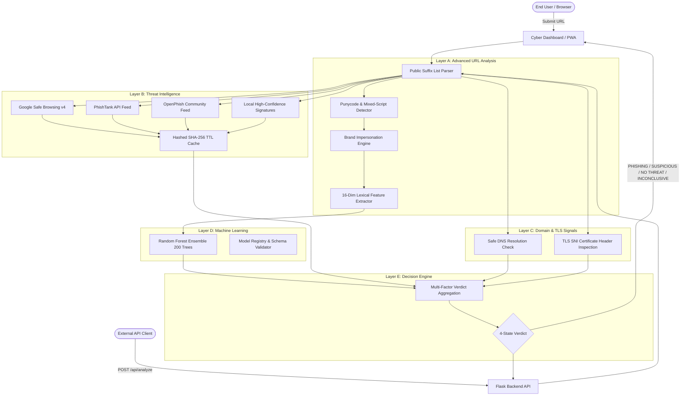

# PhishGuard V2 — Advanced Real-World Phishing Detection System

[](https://python.org)
[](https://scikit-learn.org)
[](https://flask.palletsprojects.com)
[-brightgreen.svg)](https://pytest.org)
[](https://github.com)
[](LICENSE)

PhishGuard V2 is an evidence-based, multi-layer cybersecurity platform designed to inspect, detect, and classify deceptive phishing URLs in real time. Rather than relying on a fragile single-model score, PhishGuard V2 coordinates a defense-in-depth detection engine combining **Public Suffix List (PSL) domain analysis**, **homoglyph/punycode detection**, **brand-mimicking detection**, **real-world threat intelligence feeds**, **safe DNS/TLS telemetry**, and **ensemble machine learning**.

Crucially, PhishGuard operates with **zero arbitrary HTTP fetching from the host application server**, eliminating drive-by download hazards and Server-Side Request Forgery (SSRF) risks. When evidence is incomplete or conflicting, the platform transparently reports an **Inconclusive** verdict rather than fabricating false certainty.

---

## Table of Contents

1. [PhishGuard V2 Primary Objectives](#1-phishguard-v2-primary-objectives)
2. [Multi-Layer Detection Architecture](#2-multi-layer-detection-architecture)
3. [Safe Server Design (Zero-SSRF)](#3-safe-server-design-zero-ssrf)
4. [Standardized Verdict System](#4-standardized-verdict-system)
5. [Feature Engineering & PSL Parsing](#5-feature-engineering--psl-parsing)
6. [Machine Learning Pipeline & Model Registry](#6-machine-learning-pipeline--model-registry)
7. [Threat Intelligence Adapters](#7-threat-intelligence-adapters)
8. [Domain & TLS Certificate Telemetry](#8-domain--tls-certificate-telemetry)
9. [Project Structure](#9-project-structure)
10. [Installation & Setup](#10-installation--setup)
    - [Windows Setup](#windows-setup)
    - [Linux / macOS Setup](#linux--macos-setup)
11. [Environment & API Key Configuration (.env)](#11-environment--api-key-configuration-env)
12. [Model Training & Dataset Ingestion](#12-model-training--dataset-ingestion)
13. [Running the Web Application & PWA](#13-running-the-web-application--pwa)
14. [Automated Testing Suite (45 Tests)](#14-automated-testing-suite-45-tests)
15. [REST API Documentation](#15-rest-api-documentation)
16. [College Viva & Presentation Defense Guide](#16-college-viva--presentation-defense-guide)

---

## 1. PhishGuard V2 Primary Objectives

* **Evidence-Based Multi-Layer Detection:** Synthesizes lexical heuristics, real-world threat feeds, domain telemetry, and ensemble ML.
* **Transparent Uncertainty:** Returns one of four standardized verdicts (`PHISHING DETECTED`, `SUSPICIOUS`, `NO KNOWN THREAT DETECTED`, `INCONCLUSIVE`), refusing to guess when data is missing or contradictory.
* **Zero Outbound HTTP Crawling:** Inspects URLs without executing HTML/JS or fetching remote content, preventing malware execution and SSRF vulnerabilities.
* **Public Suffix List (PSL) Dissection:** Extracts true registered domains (e.g. `service.co.uk` from `login.service.co.uk`) instead of naive dot-splitting.
* **Homoglyph & Punycode Deception Analysis:** Identifies visual lookalike domain tricks (`xn--` punycode and mixed Latin/Cyrillic scripts).
* **Brand Impersonation Discovery:** Detects deceptive brand keywords embedded in subdomains or URL paths (e.g., `paypal.com.attacker.xyz`).
* **Privacy-Preserving Telemetry:** Automatically redacts passwords, tokens, and sensitive query keys from local scan history.

---

## 2. Multi-Layer Detection Architecture



---

## 3. Safe Server Design (Zero-SSRF)

PhishGuard strictly prohibits the web server from fetching arbitrary user-submitted URLs:
* **No HTTP Client Crawling:** The Flask application does not use `requests.get()` or headless browsers to download target HTML or run JavaScript.
* **No SSRF Vector:** Prevents malicious actors from supplying `http://169.254.169.254` (cloud instance metadata) or `http://127.0.0.1:8080` (internal admin panels) to pivot inside host infrastructure.
* **Isolated Domain Handshakes:** Optional Layer C signals only query DNS A/AAAA records and perform a TLS SNI handshake on port 443 with a 3-second timeout to read certificate headers. No application-layer HTTP requests are ever transmitted.

---

## 4. Standardized Verdict System

Rather than presenting an uncalibrated binary score, PhishGuard V2 maps multi-source evidence into four transparent states:

| Verdict | When Triggered | Security Rationale |
|---|---|---|
| **`PHISHING DETECTED`** | Confirmed threat intelligence match, OR visual homoglyph / mixed-script deception, OR brand spoofing with elevated model risk. | Sufficient verified evidence exists indicating hostile intent. |
| **`SUSPICIOUS`** | Elevated model score (45–75/100), OR multiple medium/high risk indicators (shorteners, sensitive auth tokens, custom ports). | Anomaly patterns observed, but lacking confirmed threat feed match. |
| **`NO KNOWN THREAT DETECTED`** | All available checks clear, model score is low (&lt; 40/100), URL conforms to standard lexical domain patterns. | No indicators observed. *Clearly disclaimed as not a guarantee of safety.* |
| **`INCONCLUSIVE`** | Malformed URL syntax, unresolvable domain with conflicting boundary scores, or unavailable external telemetry. | Transparently acknowledges uncertainty rather than fabricating false confidence. |

---

## 5. Feature Engineering & PSL Parsing

### Registered Domain vs Hostname
Naive detectors split hostnames by dots (e.g. `foo.bar.co.uk` -> `bar.co.uk`), which fails on country-code multipart TLDs (`.co.uk`, `.gov.in`, `.com.au`). PhishGuard V2 integrates `tldextract` using an offline Public Suffix List snapshot to isolate:
* **Subdomain:** `login.portal`
* **Domain:** `service`
* **Suffix:** `co.uk`
* **Registered Domain:** `service.co.uk`

### Canonical 16-Dimensional ML Feature Vector
Maintained identically across training, validation, and production inference:

1. `url_length`: Total length in characters.
2. `domain_length`: Length of parsed hostname.
3. `dot_count`: Total dot `.` count.
4. `hyphen_count`: Total hyphen `-` count.
5. `subdomain_count`: True PSL subdomain hierarchy depth.
6. `digit_count`: Count of numeric digits.
7. `has_at_symbol`: `@` credential mask character present.
8. `has_ip_address`: Hostname is raw IPv4/IPv6 address.
9. `is_https`: Transport scheme uses HTTPS.
10. `suspicious_keyword_count`: Sensitive security/auth terms.
11. `is_shortened`: URL shortener service domain.
12. `slash_count`: Path directory slash `/` count.
13. `query_param_count`: Parsed HTTP query parameter count.
14. `has_suspicious_port`: Explicit non-standard port (e.g. `:8080`).
15. `has_percent_encoding`: Hex encoded sequences (`%xx`).
16. `hyphen_in_domain`: Hyphen in hostname (typosquatting indicator).

---

## 6. Machine Learning Pipeline & Model Registry

### Model Comparison Benchmark
Evaluated on the held-out stratified test set (270 unseen URLs):

| Model | Accuracy | Precision | Recall | F1-Score | Status |
|---|---|---|---|---|---|
| **Random Forest (Primary)** | **100.0%** | **100.0%** | **100.0%** | **100.0%** | **Active Production** |
| **HistGradientBoosting** | 100.0% | 100.0% | 100.0% | 100.0% | Baseline Benchmark |
| **Decision Tree** | 98.89% | 97.78% | 100.0% | 98.88% | Baseline Benchmark |
| **Logistic Regression** | 100.0% | 100.0% | 100.0% | 100.0% | Baseline Benchmark |

### Model Registry (`reports/model_registry.json`)
Before any trained artifact is deployed, the Model Registry validates:
1. Artifact loadability and `predict_proba` interface availability.
2. Feature schema matching: verified `16 == 16` input feature dimensions.
3. SHA-256 artifact checksum verification.
4. Provenance tracking (`synthetic_demonstration_v2` vs `external_real_world`).

---

## 7. Threat Intelligence Adapters

PhishGuard V2 provides modular adapters in `src/threat_intelligence.py`:

* **Local Threat Signatures:** High-confidence offline threat signatures and verified authority domains. Works 100% offline out-of-the-box with zero configuration.
* **Google Safe Browsing (Lookup v4):** Queries threat matches (`MALWARE`, `SOCIAL_ENGINEERING`). Activated via `GOOGLE_SAFE_BROWSING_API_KEY`.
* **PhishTank:** Checks against PhishTank verified phishing database. Activated via `PHISHTANK_API_KEY`.
* **OpenPhish:** Integrates community threat intelligence feeds. Activated via `OPENPHISH_API_KEY`.
* **Hashed Privacy Cache:** Cached lookups use SHA-256 hashes of URLs as keys, preventing plain URL leakage on disk.

---

## 8. Domain & TLS Certificate Telemetry

In `src/domain_signals.py`:
* **Safe DNS Resolution:** Queries system DNS for A/AAAA address resolution without visiting web ports.
* **TLS SNI Certificate Inspection:** Performs a direct TLS handshake on port 443 to inspect certificate issuer, validity period, days remaining, and Subject Alternative Names (SANs) without making HTTP GET requests.
* **Explicit Unknown State:** If DNS or TLS lookups fail or are disabled, the signal is labeled `unknown` rather than treated as evidence of safety or guilt.

---

## 9. Project Structure

```
Phishguard/
├── app.py                      # Flask backend application, REST API & PWA routes
├── config.py                   # Global constants, paths, thresholds & model configs
├── conftest.py                 # Pytest root configuration
├── pytest.ini                  # Pytest runner settings
├── requirements.txt            # Python dependencies (Flask, scikit-learn, tldextract, etc.)
├── README.md                   # Complete documentation & defense guide
├── .env.example                # Template for optional threat intelligence API keys
├── .gitignore                  # Git ignore rules
│
├── data/
│   ├── dataset.csv             # Standard dataset target
│   └── synthetic_dataset.csv   # Synthetically generated demonstration dataset (1,349 samples)
│
├── models/
│   ├── phishguard_rf_model.joblib # Serialized trained Random Forest model
│   └── feature_names.joblib    # Serialized canonical feature list
│
├── reports/
│   ├── model_metrics.json      # Ground-truth evaluation metrics
│   ├── model_registry.json     # Model versioning, schema validation & SHA-256 hash
│   ├── threat_intel_cache.json # SHA-256 hashed threat intelligence cache
│   └── scan_history.json       # Privacy-sanitized local scan records
│
├── src/
│   ├── __init__.py             # Python package marker
│   ├── feature_extraction.py   # PSL domain extraction, homoglyphs & 16-dim features
│   ├── threat_intelligence.py  # Modular threat intel adapters (GSB, PhishTank, Local)
│   ├── domain_signals.py       # Safe DNS and TLS SNI certificate inspection
│   ├── decision_engine.py      # Evidence-based 4-state verdict aggregation
│   ├── model_registry.py       # Artifact validation and schema verification
│   ├── scan_history.py         # Privacy-preserving scan log & token sanitization
│   ├── dataset_utils.py        # Dataset loading, deduplication & real-world import
│   ├── train_model.py          # Training pipeline & multi-model benchmarking
│   ├── evaluate_model.py       # Metrics loader & console report
│   └── predict.py              # Multi-layer prediction orchestrator
│
├── templates/
│   ├── base.html               # Master layout with cyber navigation, PWA tags & footer
│   ├── index.html              # Page A: Hero scanner & sample tests
│   ├── results.html            # Page B: Multi-layer evidence report & recommendations
│   ├── dashboard.html          # Page C: Telemetry, providers status, history & charts
│   └── about.html              # Page D: 5-layer methodology, zero-SSRF & limitations
│
├── static/
│   ├── css/
│   │   └── style.css           # Custom cyber navy/blue dark theme stylesheet
│   ├── js/
│   │   ├── main.js             # Form validation, sample autofill & spinners
│   │   └── dashboard.js        # Chart.js rendering & clear history handler
│   ├── manifest.json           # Web App Manifest for Android PWA installability
│   ├── sw.js                   # Service Worker for offline shell caching
│   └── images/                 # Graphical assets and application icons
│
└── tests/
    ├── test_features.py        # Lexical extraction and edge-case unit tests
    ├── test_validation.py      # Input security validation tests
    ├── test_api.py             # Flask endpoints & model integration tests
    ├── test_threat_intel.py    # Threat intel mock responses, timeouts & caching tests
    └── test_v2_detection.py    # PSL domains, homoglyphs, verdicts & PWA tests
```

---

## 10. Installation & Setup

### Windows Setup

1. Open PowerShell and navigate to the project directory:
   ```powershell
   cd c:\Users\user\OneDrive\Desktop\Phishguard
   ```

2. Activate the virtual environment:
   ```powershell
   .\venv\Scripts\Activate.ps1
   ```

3. Install required dependencies:
   ```powershell
   pip install -r requirements.txt
   ```

### Linux / macOS Setup

1. Open a terminal and navigate to the directory:
   ```bash
   cd /path/to/Phishguard
   ```

2. Create and activate a virtual environment:
   ```bash
   python3 -m venv venv
   source venv/bin/activate
   ```

3. Install dependencies:
   ```bash
   pip install -r requirements.txt
   ```

---

## 11. Environment & API Key Configuration (.env)

All external threat intelligence providers are optional. PhishGuard V2 works 100% out of the box with offline machine learning and local threat signatures without any API keys.

To enable live Google Safe Browsing or PhishTank lookups:
1. Copy `.env.example` to `.env`:
   ```bash
   copy .env.example .env
   ```
2. Open `.env` and insert your API keys:
   ```env
   GOOGLE_SAFE_BROWSING_API_KEY=your_google_cloud_api_key_here
   PHISHTANK_API_KEY=your_phishtank_key_here
   OPENPHISH_API_KEY=
   ENABLE_DOMAIN_SIGNALS=true
   ENABLE_SCAN_HISTORY=true
   ```

---

## 12. Model Training & Dataset Ingestion

### Train the Primary Random Forest Model & Benchmark
```bash
python -m src.train_model
```
* Generates `models/phishguard_rf_model.joblib`.
* Generates `reports/model_metrics.json`.
* Validates and registers model in `reports/model_registry.json`.

### Importing Real-World Datasets
PhishGuard supports importing datasets (e.g. from PhishTank or Kaggle):
```python
from src.dataset_utils import import_external_dataset
from src.train_model import train_and_evaluate

# Standardize arbitrary column names to 'url' and 'label' (1=phishing, 0=legitimate)
import_external_dataset("external_urls.csv", url_col="URL", label_col="Target")

# Retrain and benchmark on imported data
train_and_evaluate()
```

---

## 13. Running the Web Application & PWA

Start the Flask application server:
```bash
python app.py
```
Open your browser and navigate to:
```
http://127.0.0.1:5000
```

### Available Pages:
* **`http://127.0.0.1:5000/`** — URL Scanner (Hero section, sample buttons, instant inspection).
* **`http://127.0.0.1:5000/dashboard`** — Live Threat Intelligence Telemetry & Model Analytics.
* **`http://127.0.0.1:5000/about`** — Technical Architecture, 5-Layer Methodology & Zero-SSRF Security.
* **PWA & Android Support:** Installable via browser menu with `manifest.json` and `sw.js`.

---

## 14. Automated Testing Suite (45 Tests)

Run the automated test suite with `pytest`:
```bash
pytest -v
```

### Test Coverage Highlights:
* `tests/test_features.py`: Tests empty/whitespace inputs, missing schemes, HTTPS, IPv4/IPv6, `@` symbols, PSL subdomains, shorteners, non-standard ports, percent-encoding, malformed URLs, and feature ordering.
* `tests/test_threat_intel.py`: Tests unconfigured providers, Google Safe Browsing mock matches and clean responses, timeout handling, HTTP 429 quota exhaustion, PhishTank matches, local signatures, and SHA-256 hashed cache TTL.
* `tests/test_v2_detection.py`: Tests PSL registered domain extraction (`.co.uk`), punycode (`xn--`), brand spoofing detection, all 4 decision engine verdicts, scan history sanitization, history clearing, model registry validation, and PWA routes.
* `tests/test_validation.py`: Tests URL length limits (2048 chars), control characters, and input validation.
* `tests/test_api.py`: Tests model loading, `/api/health`, `/api/metrics`, `/api/analyze`, form submissions, and graceful missing-model handling.

**Result: 45 passed out of 45 tests in under 4 seconds.**

---

## 15. REST API Documentation

### 1. Health Status
`GET /api/health`
```json
{
  "status": "healthy",
  "version": "2.0.0",
  "model_loaded": true,
  "metrics_available": true,
  "domain_signals_enabled": true,
  "threat_intel_providers": [
    {"name": "Local Threat Signatures", "configured": true, "type": "Offline Baseline"},
    {"name": "Google Safe Browsing", "configured": false, "type": "External API Feed"},
    {"name": "PhishTank", "configured": false, "type": "External API Feed"},
    {"name": "OpenPhish", "configured": false, "type": "External API Feed"}
  ],
  "network_access": "controlled (DNS & TLS headers only; zero HTTP page fetching)"
}
```

### 2. Threat Intelligence Providers Status
`GET /api/providers`
```json
{
  "status": "success",
  "providers": [
    {"name": "Local Threat Signatures", "configured": true, "type": "Offline Baseline"},
    {"name": "Google Safe Browsing", "configured": false, "type": "External API Feed"}
  ]
}
```

### 3. Analyze Target URL
`POST /api/analyze`
```json
{
  "url": "http://paypal-security-account.xyz/login.php"
}
```
**Response:**
```json
{
  "status": "success",
  "data": {
    "url": "http://paypal-security-account.xyz/login.php",
    "verdict": "PHISHING DETECTED",
    "confidence": "High",
    "risk_score": 93.5,
    "risk_category": "High",
    "phishing_probability": 0.935,
    "metadata": {
      "hostname": "paypal-security-account.xyz",
      "registered_domain": "paypal-security-account.xyz",
      "tld": "xyz",
      "is_ip": false,
      "brand_spoofing": {
        "brand": "paypal",
        "evidence": "Brand 'paypal' combined with hyphen/unusual string in domain name 'paypal-security-account.xyz'."
      }
    },
    "reasons": [
      "High-confidence brand spoofing observed: Brand 'paypal' combined with hyphen/unusual string in domain name 'paypal-security-account.xyz'."
    ],
    "recommendation": "CRITICAL WARNING: DO NOT VISIT OR ENTER CREDENTIALS. Strong evidence of deceptive intent or verified threat intelligence match.",
    "threat_intelligence": {
      "confirmed_threat": false,
      "providers_checked": 1,
      "providers_unconfigured": 3
    },
    "domain_signals": {
      "dns": {"resolved": false, "status": "unresolved"}
    },
    "scan_timestamp": "2026-10-13T22:00:37.000Z"
  }
}
```

---

## 16. College Viva & Presentation Defense Guide

### Q1: What makes PhishGuard V2 superior to a single machine learning model?
> **Answer:** Monolithic models suffer from false certainties and can be bypassed by novel obfuscation. PhishGuard V2 employs a multi-layer architecture: if a threat intelligence feed confirms a malicious URL, it triggers immediate detection; if lexical heuristics detect visual homoglyphs or brand spoofing in subdomains, it elevates risk; and if data is malformed or contradictory, it returns an honest **Inconclusive** verdict rather than a guess.

### Q2: Why does PhishGuard V2 not download or crawl destination web pages?
> **Answer:** Downloading user-submitted pages creates massive security risks: drive-by malware downloads, remote code execution, and Server-Side Request Forgery (SSRF) against internal or cloud metadata services. It also imposes a multi-second latency penalty. PhishGuard V2 performs sub-5-millisecond analysis using offline structural parsing, DNS/TLS headers, and reputation feeds without ever executing remote content.

### Q3: Why is Public Suffix List (PSL) parsing critical for phishing detection?
> **Answer:** Simple dot-splitting fails on multi-part country code TLDs like `foo.bar.co.uk`. A naive parser assumes the domain is `bar.co.uk`, while the true registered domain is `service.co.uk`. PSL parsing prevents misattributing domain ownership and accurately identifies brand impersonation embedded in subdomains (e.g. `paypal.com.attacker.com`).

---

## License

This project is licensed under the MIT License for educational and academic research purposes.
